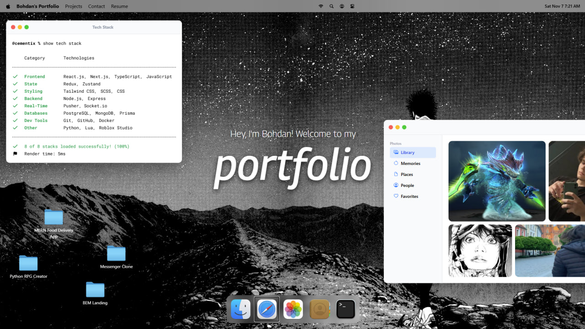

# hi! ♡ i'm Bohdan

  &nbsp;
  &nbsp;

  &nbsp;
  &nbsp;
  &nbsp;

Frontend developer and student in Wrocław. I build complete products, not just pages: I care about how a thing looks and feels, and I also write the database, the payments and the tests behind it. 

Outside the web, I founded and lead **[larpcoders](https://www.roblox.com/communities/590020680/larpcoders#!/about)**, a four-person Roblox studio where we build games in Luau.

Looking for a **frontend or full-stack role** (React / Next.js / TypeScript) in Wrocław or remote. Available immediately, 40+ hours a week.

[Portfolio](https://cementixx-macos-portfolio.vercel.app/) · [CV](https://cementixx-macos-portfolio.vercel.app/files/resume.pdf) · [LinkedIn](https://www.linkedin.com/in/bohdanCementix/)

## ✦ Listiq — my main project

A media tracker for movies, series, anime, manga, books and games. One library with ratings, reviews, lists, a social profile, swipe-style discovery and a Spotify Wrapped–style year in review.

**[Try the live demo — one click, no sign-up ↗](https://listiq-topaz.vercel.app/)**

- **Product:** a private demo sandbox per visitor, a Pro plan on Stripe (test mode), CSV import from Letterboxd and Goodreads, insights with charts and an activity heatmap, public share pages
- **Engineering:** Next.js 16 (App Router, Server Actions), TypeScript, PostgreSQL + Prisma, 7 catalog providers synced by Vercel Workflow, rate limiting in Postgres, privacy enforced in database queries
- **Quality:** 74 unit, 29 integration and 5 Playwright end-to-end tests in CI on every push · Lighthouse 100 for accessibility · Docker setup

[Source code](https://github.com/cementix/listiq) · [Case study: how and why it's built this way](https://github.com/cementix/listiq/blob/master/docs/case-study.md)

## ✦ macOS Portfolio

An interactive portfolio styled like a macOS desktop: open projects in Finder, drag windows around, jump to my CV from the Dock. React, Vite, GSAP, Zustand.

[Open portfolio ↗](https://cementixx-macos-portfolio.vercel.app/) · [Source code](https://github.com/cementix/cementixx_macos_portfolio)

## Open source

- **[strawberry-graphql/strawberry](https://github.com/strawberry-graphql/strawberry)** — added a `record_exception_filter` option to the OpenTelemetry extension *(in review)*
- **[atomityhq/atomity-cms](https://github.com/atomityhq/atomity-cms)** — fixed a sidebar logo label mismatch *(merged)*

## Roblox — larpcoders

I run **[larpcoders](https://www.roblox.com/communities/590020680/larpcoders#!/about)**, a small Roblox development group. We build games in Luau with server-authoritative game logic, and model assets in Blender.

## Other projects

| Project | What it does | Stack |
| --- | --- | --- |
| [Messenger Clone](https://github.com/cementix/messenger-clone) · [demo](https://messenger-clone-two-weld.vercel.app/) | Private and group chats, real-time messages, read receipts | Next.js, TypeScript, MongoDB, Pusher |
| [Food Ordering App](https://github.com/cementix/mern-food-ordering-app) · [demo](https://mern-food-ordering-app-frontend-4cv5.onrender.com/) | Restaurant menus, orders, Stripe Checkout | React, Express, MongoDB |
| [Issue Tracker](https://github.com/cementix/issue-tracker) · [demo](https://issue-tracker-rose-psi.vercel.app/) | Create, assign and filter issues with a dashboard | Next.js, TypeScript, Prisma, PostgreSQL |

## Tech I work with

**Frontend:** React, Next.js, TypeScript, Tailwind CSS, Motion, GSAP, Zustand  
**Backend & data:** Node.js, Express, PostgreSQL, Prisma, MongoDB, Zod  
**Payments & infra:** Stripe, Vercel, Docker, GitHub Actions  
**Testing & quality:** Playwright, Node test runner, integration tests on real Postgres, accessibility (WCAG AA)  
**On the side:** Luau (Roblox), Blender, Python

✉ Fastest way to reach me: [LinkedIn](https://www.linkedin.com/in/bohdanCementix/) · [CV (PDF)](https://cementixx-macos-portfolio.vercel.app/files/resume.pdf)
