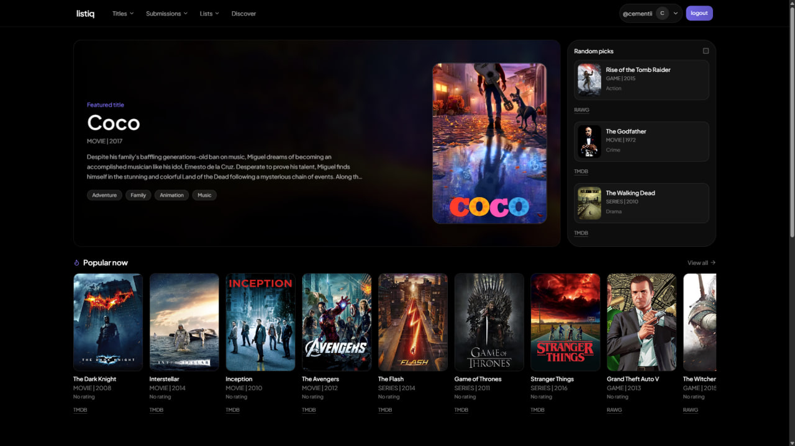
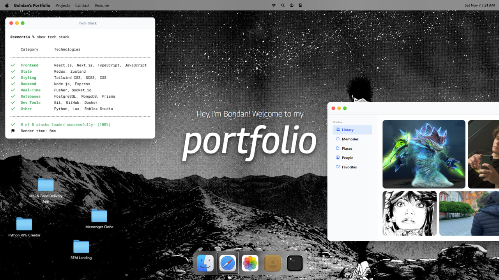

# hi! ♡ i'm Bohdan

Full-stack developer based in Wrocław, Poland. I build web apps with React, Next.js, and TypeScript. I’m open to frontend and full-stack roles.

[Portfolio](https://cementixx-macos-portfolio.vercel.app/) · [CV](https://cementixx-macos-portfolio.vercel.app/files/resume.pdf) · [LinkedIn](https://www.linkedin.com/in/bohdanCementix/)

## ✦ Featured projects

### Listiq

A personal media library for tracking what you watch, read, and play. Search across movies, anime, manga, games, and books, save titles to custom lists, and discover what to pick up next.

Built with Next.js, TypeScript, PostgreSQL, and Prisma. Includes catalog imports from multiple providers, moderation for user submissions, and CI that runs migrations and tests against PostgreSQL.

[Open Listiq ↗](https://listiq-topaz.vercel.app/)

<!-- After uploading the video, append: · [Watch 1-minute demo](YOUR_VIDEO_URL) -->

### macOS Portfolio

An interactive portfolio styled like a macOS desktop. Open projects in Finder, drag windows around, or jump to my CV and contact details from the desktop.

Built with React, Vite, GSAP, and Zustand.

[Open portfolio ↗](https://cementixx-macos-portfolio.vercel.app/) · [Source code](https://github.com/cementix/cementixx_macos_portfolio)

## Other projects

- **Messenger Clone** — Private and group chats with real-time messages and read receipts. Next.js, TypeScript, MongoDB, Pusher. [Code](https://github.com/cementix/messenger-clone) · [Demo](https://messenger-clone-two-weld.vercel.app/)
- **Food Ordering App** — Browse restaurant menus, place orders, and pay through Stripe Checkout. React, Express, MongoDB. [Code](https://github.com/cementix/mern-food-ordering-app) · [Demo](https://mern-food-ordering-app-frontend-4cv5.onrender.com/)
- **Issue Tracker** — Create and assign issues, filter by status, and track progress on a dashboard. Next.js, TypeScript, Prisma, PostgreSQL. [Code](https://github.com/cementix/issue-tracker) · [Demo](https://issue-tracker-rose-psi.vercel.app/)
- **Python RPG Character Creator** — A desktop app for allocating character stats, choosing skills, and exporting characters to JSON. Python, CustomTkinter. [Code](https://github.com/cementix/py_rpg_char_creator)
- **BEM Landing Page** — A responsive landing page built with HTML, Sass, and BEM. [Code](https://github.com/cementix/layout_landing-page) · [Demo](https://cementix.github.io/layout_landing-page/)

## Tech I work with

**Frontend:** React, Next.js, TypeScript, Tailwind CSS  
**Backend & data:** Node.js, Express, PostgreSQL, Prisma, MongoDB  
**On the side:** Python and Roblox projects with Luau and Blender
